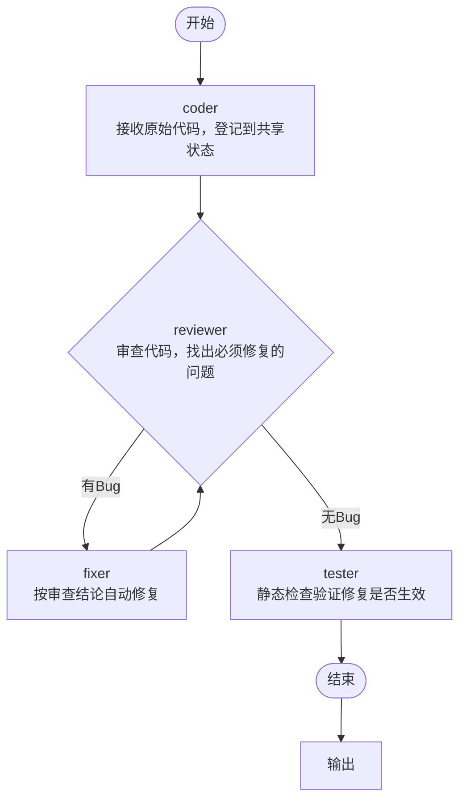

# Design.md — 代码审查 Workflow 设计文档（Homework2）

## 1. 项目目标与设计取舍

Homework2 要求搭建一个 2–3 个 Agent 协作的简单 Workflow，理解 **Workflow 编排、Agent 间通信、状态管理**。

本项目的选择：

| 决策 | 选择 | 理由 |
|---|---|---|
| 流程方向 | 代码审查流程：编码 → 审查 → 修复 → 验证 | 端到端最完整，可复用 Homework1 的审查能力 |
| 编排实现 | **自研轻量编排器**（不把流程交给框架） | 评分重点考察「Workflow 是否跑通 / 状态管理是否合理」，编排逻辑自己实现更有说服力 |
| Agent 内部 | 仍用 LangChain 的 `ChatOpenAI` 调用大模型 | 与 Homework1 一致，复用已有经验，少踩坑 |
| 输入方式 | 与 Homework1 **完全相同的命令行交互** | 用户要求：交互一致，只把输出从「建议+注释」换成「修复结果」 |
| 源文件 | **全程只读**，修复结果只输出到终端 | 用户要求：`test.cpp` 不能被修改 |
| 客观验证 | 内置 C++ 确定性静态检查器 | 避免「大模型说修好了但其实没修好」，让验证有客观依据 |

## 2. 总体架构

工作流分为三层，层与层之间只通过「状态」和「消息」通信：

```
┌──────────────────────────────────────────────────────────────┐
│  接入层   main.py（交互循环，与 Homework1 一致）               │
│            output.py（把最终状态渲染成三部分输出）              │
├──────────────────────────────────────────────────────────────┤
│  编排层   workflow/graph.py        声明式流程定义              │
│            workflow/orchestrator.py 执行引擎（分支/循环/重试）  │
│            workflow/state.py       共享状态（黑板）            │
│            workflow/message.py     Agent 间消息协议            │
├──────────────────────────────────────────────────────────────┤
│  执行层   agents/   coder / reviewer / fixer / tester          │
│            tools/  file_reader（只读）/ cpp_static_checker      │
└──────────────────────────────────────────────────────────────┘
```

### 2.1 为什么用「黑板 + 消息」而不是 Agent 之间直接调用

- **解耦**：Agent 之间不互相 `import`、不互相传函数参数，只读写共享状态、投递消息。
  任何一个 Agent 都能被替换（真 LLM / Mock / 纯规则），流程其余部分不用改。
- **可追溯**：所有消息统一进入 `WorkflowState.messages`，配合事件轨迹 `trace`，
  可以完整回放「哪个 Agent 在什么时候产出了什么」，便于排查和演示。
- **可扩展**：新增 Agent 只需实现 `BaseAgent.handle(state)`，再在 `graph.py` 里加一个节点和一条边。

## 3. Workflow 流程

### 3.1 流程图



### 3.2 节点职责

| 节点 | Agent | 输入 | 输出（写入共享状态） | 发出的消息 |
|---|---|---|---|---|
| coder | `CoderAgent` | 用户输入（代码或文件路径） | `original_code`（只读快照）、`code` | `CODE_READY` → reviewer |
| reviewer | `ReviewerAgent` | `state.code` | `review`（问题清单 + has_issues） | `REVIEW_RESULT` → fixer / tester |
| fixer | `FixerAgent` | `state.review.issues` | `code`（修复后代码）、`fix_report` | `FIX_DONE` → reviewer |
| tester | `TesterAgent` | `original_code` + `code` | `test_result`（验证结论） | `TEST_RESULT` → orchestrator |

### 3.3 流程控制

| 控制类型 | 实现 |
|---|---|
| **顺序执行** | `coder → reviewer`，按 `graph.py` 声明顺序执行 |
| **条件分支** | reviewer 之后按 `has_issues` 走 `fixer` 或直接走 `tester` |
| **循环** | `fixer → reviewer` 回边，形成「修复后再审」的循环 |
| **循环上限** | 编排器在 reviewer 即将执行第 `max_rounds + 1` 轮时强制转 `tester`，保证一定终止 |
| **重试** | 单节点抛异常时自动重试 1 次，仍失败则终止流程并给出明确错误，不崩溃 |
| **取消** | 编排器支持 `cancel_check`，可在节点之间中止流程 |

## 4. 状态管理

`WorkflowState`（`workflow/state.py`）是一次运行的全部状态，字段分为四组：

| 分组 | 字段 | 说明 |
|---|---|---|
| 输入 | `raw_input` / `source_name` / `language` | 用户原始输入、来源名（仅用于显示）、语言 |
| 产物 | `original_code` | 原始代码**只读快照**，任何 Agent 都不得修改 |
| | `code` | 当前工作副本，fixer 每轮更新 |
| | `review` / `fix_report` / `test_result` | 各 Agent 的结构化结论 |
| 流程控制 | `round` / `max_rounds` / `finished` / `stop_reason` / `error` | 当前轮次、上限、终止原因 |
| 通信 | `messages` / `trace` | 全部 Agent 消息、事件轨迹（可导出 JSON） |

设计要点：

1. **只读快照 + 工作副本**：`original_code` 全程不变，`code` 可以反复修改，
   既能对比差异，也保证原始输入不被污染；
2. **字段所有权**：每个 Agent 只写自己的字段（reviewer 只写 `review`），避免互相覆盖；
3. **可序列化**：`to_json()` 输出事件轨迹、全部消息和最终代码，配合 `--log` 生成执行日志。

## 5. Agent 间通信协议

消息定义见 `workflow/message.py`：

```python
Message(sender, receiver, msg_type, content, payload, created_at)
```

| msg_type | 发送方 → 接收方 | payload 主要字段 |
|---|---|---|
| `CODE_READY` | coder → reviewer | `code`, `language` |
| `REVIEW_RESULT` | reviewer → fixer / tester | `has_issues`, `issues`, `round` |
| `FIX_DONE` | fixer → reviewer | `code`, `changes`, `round` |
| `TEST_RESULT` | tester → orchestrator | `passed`, `resolved`, `remaining`, `introduced` |

第 5 节与第 4 节配合：消息负责「通知与留痕」，共享状态负责「传递大对象」（代码全文不进消息日志，进状态）。

## 6. 各 Agent 的 Prompt 与实现要点

### 6.1 reviewer（复用 Homework1 审查经验）

系统提示词沿用了 Homework1 沉淀的规则：
严格基于源码原文、引用的行必须与源码逐字一致、不确定的不报（宁可少报不可错报）、
每个问题用「位置 → 问题本质 → 修复方式」描述。

在此基础上增加**确定性证据**：每次审查先跑静态检查器，把结果连同源码一起交给模型，
模型结论与静态检查结果按「行号 + 标题」去重合并，形成最终问题清单。

### 6.2 fixer（自动修复 + 规则兜底）

1. 把「当前代码 + 必须修复的问题清单」交给模型，要求输出修复后的完整代码和逐条修改说明；
2. **确定性复核**：对模型返回的代码再跑一次静态检查，如果仍能测出问题（说明模型漏改），
   用 `apply_safe_fixes` 规则修复兜底补齐；
3. 修改说明全部记入 `fix_report.changes`，作为「修复概览」的数据来源。

### 6.3 tester（客观验证）

不依赖大模型，用两把尺子衡量修复：

| 检查项 | 方法 |
|---|---|
| 问题是否真的消失 | 对比修复前后静态检查的问题编号集合（已修复 / 仍未修复 / 本次新引入） |
| 是否真的改了代码 | 用 `difflib` 统计实际改动行数，防止「声称修复但代码没变」 |

## 7. 确定性静态检查器（tools/cpp_static_checker.py）

- **纯文本规则匹配**，不编译、不执行、不写文件；
- 每条问题带稳定编号 `规则@行号`，修复前后可比对；
- 规则数据驱动：逐行规则写在 `RULES` 表，需要上下文的规则（如递归释放函数）写成专门函数；
- 设计原则：**高置信度、宁可少报不可错报**，不会把正确代码判为问题（有专门测试用例）。

针对 `test.cpp` 的演示，实现了两条规则：

| 规则编号 | 检测内容 |
|---|---|
| `CPP-STL-TEMPLATE-ARG` | `priority_queue<元素类型, vector<指针>, 比较器>` 模板参数不一致 |
| `CPP-FREE-ORDER` | 递归释放函数：判空条件写反、先 `delete` 后访问子节点 |

## 8. 输出设计

`output.py` 把最终状态渲染为三部分（对应 Homework2 与 Homework1 的差异）：

1. **修复概览**：原始问题数、第一轮审查结论、修复来源、逐条修复清单（改前 / 改后 / 原因）；
2. **修复后的完整代码**：可直接复制，明确标注源文件未被修改；
3. **验证结论**：修复前后问题数、已修复 / 仍未修复 / 本次新引入。

末尾附加「执行过程」（节点序列 + 每轮审修记录）与「修复前后差异」（unified diff）。

**源文件安全**：全流程只把代码保存在内存字符串里，没有任何写文件的代码路径
（唯一写文件的地方是可选参数 `--log` 指定的日志文件）。测试 `test_source_file_never_modified`
会校验运行前后 `test.cpp` 的字节完全一致。

## 9. 错误处理

| 场景 | 处理方式 |
|---|---|
| 文件不存在 / 是目录 / 无权限 / 编码异常 | `file_reader` 返回明确错误，交互模式提示后继续等待输入 |
| 空输入 | 提示「输入为空，请重新输入」，不进入流程 |
| 一次输入多个文件 | 提示逐个提交（与 Homework1 一致） |
| 节点内部异常 | 编排器重试 1 次；仍失败则记录 `error`、终止流程、输出错误信息而不崩溃 |
| 大模型未配置 / 调用失败 | 给出明确提示（指出检查 `.env` 与依赖），并终止本次运行而不崩溃 |
| 修复循环不收敛 | 达到 `max_rounds` 强制转验证，验证结论如实报告「仍未修复」 |
| 用户 Ctrl+C / `exit` | 正常退出，不抛栈 |

## 10. 可扩展性（对应评审标准 20%）

1. **加一个新 Agent**：新建 `agents/xxx.py` 继承 `BaseAgent`，在 `graph.py` 里
   `add_node(...)` 加节点、`add_edge(...)` 连边即可，编排器和其他 Agent 都不用改；
2. **改流程**：流程是声明式的（`graph.py`），增删节点、改分支条件都在一处完成，
   `python main.py --graph` 可随时打印最新的流程图（文字 + mermaid）；
3. **换 Agent 实现**：Agent 只依赖 `BaseAgent` 接口（`handle(state)`），
   换成另一种大模型或用规则引擎实现都行，编排层和其他 Agent 不用改；
4. **加检查规则**：静态检查器规则表数据驱动，加一条规则即多一项检查；
5. **换语言**：`language` 字段 + 工具按语言分派，C++ 之外的语言可接入其它检查器。

## 11. 与 Homework1 的对比

| 维度 | Homework1 | Homework2 |
|---|---|---|
| 形态 | 单个 Agent（create_agent） | 4 个 Agent 的 Workflow |
| 交互 | 路径/代码输入、`END` 结束、`exit` 退出 | **完全相同** |
| 输出 | 功能概括 + Bug 建议 + 带注释代码 | **修复概览 + 修复后代码 + 验证结论** |
| 记忆 | LangGraph `InMemorySaver` | 共享状态本身即上下文（每次运行独立） |
| 循环 | 无 | 审查-修复受控循环（上限可配） |
| 验证 | 无 | 静态检查前后对比，客观报告修复效果 |
